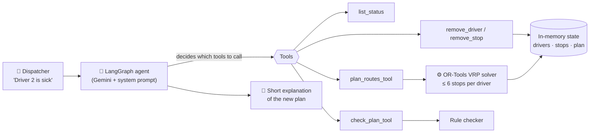

# 🚚 Delivery Rerouting Agent


An AI dispatch assistant for last-mile delivery. You describe a disruption in plain language (*"Driver 2 is sick"*, *"Cancel order 7"*), and the agent updates the data, re-plans every route with a real vehicle-routing solver, checks the business rules, and explains the new plan.

> **The optimizer does the math. The agent decides what to ask it and what to do with the answer.**
>
> Google OR-Tools can find the shortest routes, but it can't read *"Driver 2 is sick"* or explain why a plan is impossible. An LLM can understand the request, but it shouldn't be trusted to solve a routing problem in its head. This project gives each one the job it's good at.

---

## ✨ What it does

- **Understands disruptions in plain language**: sick drivers, cancelled orders, *"what's today's plan?"*
- **Re-plans optimally** with Google OR-Tools (vehicle routing, guided local search, 2-second limit)
- **Enforces a hard business rule**: no driver takes more than 6 stops
- **Checks its own work** with a separate rule checker before answering
- **Handles impossible situations**: when no valid plan exists, it says so and suggests options instead of making something up
- **Shows its reasoning**: the chat UI lists every tool the agent called, with inputs and outputs

## 💬 Example conversation

A real run with Gemini (`gemini-3.5-flash`), with the tool calls the agent chose:

> **🧑 Show me today's plan.**
> 🔧 `list_status` → `plan_routes_tool` → `check_plan_tool`
>
> **🤖** Driver 2: stops 9 → 11 → 3 → 8 → 6 → 7 (23.62 km) · Driver 3: stops 2 → 12 → 4 → 10 → 1 → 5 (21.18 km) · Driver 1: no stops needed. **Total: 44.80 km**

> **🧑 Driver 2 is sick.**
> 🔧 `remove_driver("Driver 2")` → `plan_routes_tool` → `check_plan_tool`
>
> **🤖** Driver 2 has been removed. Driver 1 takes stops 9 → 11 → 3 → 8 → 6 → 7 and Driver 3 keeps 2 → 12 → 4 → 10 → 1 → 5. **Total: 44.80 km**

> **🧑 Driver 3 is also out.**
> 🔧 `remove_driver("Driver 3")` → `plan_routes_tool`
>
> **🤖** The plan is currently **infeasible**. With only Driver 1 available, capacity is 6 stops, so 6 of the 12 stops can't be covered. **Options:** bring Driver 2 or Driver 3 back, or postpone 6 stops.

> **🧑 Cancel order 7 and order 9.**
> 🔧 `remove_stop(7)` → `remove_stop(9)` → `plan_routes_tool`
>
> **🤖** Orders 7 and 9 are cancelled, but the plan is still **infeasible**: 10 stops and one driver with a 6-stop limit. **Options:** bring a driver back, or postpone 4 more stops.

## 🏗️ How it works



The agent runs a reason-and-act loop: it reads the request, calls tools, reads their output, and decides what to do next until it can answer. The loop is capped at 15 steps so it can never run forever.

**Inside the solver** ([`solver.py`](solver.py)):
- Builds a distance matrix in integer meters (OR-Tools works in integers) from straight-line (haversine) distances
- Every driver starts and ends at the depot
- A *count dimension* adds 1 per stop and caps each route at 6, which makes the rule a hard constraint rather than a soft penalty
- Finds a first solution with `PATH_CHEAPEST_ARC`, then improves it with guided local search for 2 seconds
- Returns `infeasible` with a plain-English reason instead of raising, so the agent can explain the problem to the user

**Tool design** ([`tools.py`](tools.py)): every tool returns a short, readable string and never raises on bad input. An unknown driver or order id comes back as an error message the agent can react to. The docstrings are the tools' "API docs" for the LLM.

## 📁 Project structure

```
.
├── data.py           # Depot, 3 drivers, 12 seeded stops in Casablanca, State + reset()
├── solver.py         # plan_routes() with OR-Tools, and check_plan() rule checker
├── tools.py          # The 5 LangChain tools the agent can call
├── agent.py          # LangGraph agent, system prompt, terminal chat loop
├── app.py            # Streamlit chat UI with live routes sidebar
└── tests/
    ├── test_solver.py
    └── test_tools.py
```

## 🚀 Getting started

**Requirements:** Python 3.11+ and a [Gemini API key](https://aistudio.google.com/apikey).

```bash
git clone https://github.com/Arun-2010/Delivery-Rerouting-Agent.git
cd Delivery-Rerouting-Agent

python -m venv .venv
.venv\Scripts\activate            # Windows
# source .venv/bin/activate       # macOS / Linux

pip install -r requirements.txt
cp .env.example .env              # then add your GEMINI_API_KEY
```

`.env`:
```
GEMINI_API_KEY=your-key-here
MODEL_NAME=gemini-3.5-flash
```

**Run it:**

```bash
streamlit run app.py   # web chat UI at http://localhost:8501
python agent.py        # or chat in the terminal
pytest -q              # 15 offline tests, no API key needed
```

## 🧪 Testing

The tests are fast and fully offline (no LLM calls). They check that:
- with 3 drivers, every stop is assigned exactly once and no driver goes over 6 stops
- 2 drivers split 12 stops 6/6
- 1 driver with 12 stops returns `infeasible` instead of crashing
- empty inputs return a clear status
- tools return error strings for unknown drivers or orders, and change the state for valid ones

During development, the agent loop was also checked offline with a scripted fake LLM, including the 15-step loop cap.

## 📐 Scope and simplifications

This is a small project, built to show the agent pattern clearly rather than to be production-ready:
- 3 drivers, 12 stops, 1 depot in Casablanca, with fake coordinates (fixed seed, so results are reproducible)
- Straight-line distances, not road distances
- One business rule: at most 6 stops per driver
- In-memory data, single user
- The solver minimizes **total** distance, so it may leave a driver idle when two routes cover everything (as in the first plan above)

## 🔭 What I'd add next

- **Real road distances and travel times** with OSRM
- **Delivery time windows** (OR-Tools supports these with a time dimension)
- **Workload balancing** so routes are fair, not just short
- **A database** for drivers, orders, and plan history
- **Human approval** before a new plan is sent to drivers
- **An eval suite** of disruption scenarios to measure the agent's tool choices and answers automatically
